<p align="center"></p>

<p align="center">
  <a href="https://github.com/m5stack-lab/Liner/releases/latest"></a>
  
  
  
  
</p>

<p align="center"><b>Now-playing liner notes for your <a href="https://volumio.com/">Volumio 4</a> streamer, on a 4" six-color e-paper screen.</b><br>
Album art, title, artist and the format line on an <a href="https://docs.m5stack.com/en/core/PaperColor">M5Stack PaperColor</a>, plus a dashboard on your phone.<br>The screen only redraws when the music changes.</p>

The name is a nod to *liner notes*: the printed text and art that ship inside an album's packaging. Liner recreates them on e-paper.

<p align="center"></p>

### What it does

- **Now playing on paper.** Full-width album art, title, artist, album and a bold format line for the audio nerds (`TIDAL 48 kHz/24 bit · 2304 kbps`)
- **Redraws only on a track change.** A Spectra 6 refresh takes about 15 s, so Liner never refreshes for nothing
- **Covers are ready before you need them.** The last 4 are cached, and the next two in Volumio's queue are fetched while the current track plays
- **A dashboard for every screen.** Phone, tablet or laptop, light or dark, at `liner.local`
- **QR codes on the glass.** For setup, and for when Volumio can't be reached
- **Buttons.** Next, previous, and setup on demand
- **Over-the-air updates**, switchable from the dashboard
- **Idle screensaver** of generative Spectra 6 patterns

## What's new in v1.9

| Highlight | What changed |
|---|---|
| ⚡ **Faster covers** | Album covers are cached and the next two are pre-fetched for playlists. A cached track change skips the 1–2 s download |
| 📱 **New dashboard** (v1.8) | Responsive on phone, tablet and laptop, dark mode, switches that apply instantly, an optional password, and a QR code to open it on your phone |
| 🔁 **Dashboard leads, paper follows** (v1.8.1) | A new track shows on the dashboard about a second after it starts, while the e-paper is still refreshing |
| 🔳 **QR codes on the screen** (v1.8) | Scan to join setup, scan to open setup, scan to fix an unreachable Volumio |
| 🛡️ **Security** (v1.7) | Arduino-ESP32 3.3.12, which patches CVE-2026-42854 in the settings web server |

Full notes: [releases](https://github.com/m5stack-lab/Liner/releases).

## Built for Volumio 4

| Your Volumio | Use | Notes |
|---|---|---|
| **Volumio 4** | [**Latest release**](https://github.com/m5stack-lab/Liner/releases/latest) | Built and tested against Volumio 4 (v1.6.0 onward) |
| Volumio 3 | [v1.5.0](https://github.com/m5stack-lab/Liner/releases/tag/v1.5.0) (`Liner-v1.5.0-merged.bin`, flash at `0x0`) | The last release made for Volumio 3. It predates the v1.7.0 toolchain update, so its settings page still has CVE-2026-42854 (see [ROADMAP.md](ROADMAP.md)), and it has no dashboard, QR codes or password. Keep it on a home network you trust, or upgrade to Volumio 4 |

Liner talks to Volumio 4's REST API on port 3000 and needs no Volumio plugin:

| Endpoint | When | Why |
|---|---|---|
| `GET /api/v1/getState` | every 2 s (every 30 s while Volumio is unreachable) | title, artist, album, cover, service, format, position |
| `GET /api/v1/getQueue` | once after each redraw | the next two tracks' covers, to pre-fetch |
| `GET /api/v1/commands/?cmd=next` · `prev` | on a button press | skip forward or back |

Volumio presents every source (local library, Tidal, Spotify, internet radio and more) through this one interface, so Liner doesn't need to know which service is playing. It only reads what Volumio reports.

## The dashboard

<p align="center"></p>

Open `http://liner.local/` (or Liner's IP) from anything on your network. It's one page served from Liner's flash. It works without the internet, and it lays itself out for the screen it's on:

- **Phones** get bottom tabs within thumb reach, large tap targets, and 16 px inputs so iOS doesn't zoom
- **Tablets and laptops** get header tabs and a two-column layout. On wide screens, the album art sits beside the track and device info becomes a row of tiles
- **Dark mode** follows your system

| Tab | What's there |
|---|---|
| **Now** | The track playing (art, title, artist, album, format), a status pill (*Playing*, *Updating screen*, *No Volumio*, *Setup mode*), and device info: network, IP, `liner.local`, signal, Volumio host, firmware, uptime |
| **Settings** | Switches for **OTA updates**, **Idle screensaver** and **Password protection** that apply as soon as you tap them. A **Wi-Fi & Volumio** form with an on-demand network scan. A **Scan to open** QR code with Liner's address (its setup-network IP before a network is set, its LAN IP after) |
| **Help** | Answers for a frozen-looking screen, the QR screen, missing art, Wi-Fi trouble, OTA and a forgotten password |

**The dashboard leads, the paper follows.** Liner saves each new track's info before it starts drawing, and keeps answering the dashboard while the e-paper refreshes, so the page shows the new track within a poll (about 2 s). The pill reads **Updating screen** until the panel catches up. The dashboard reads the same state the e-paper uses, so opening it doesn't add any requests to Volumio.

<details>
<summary><b>Password protection</b></summary>

Off by default. Turn on **Password protection** in Settings and pick a password (4–64 characters). The browser then asks for it, with username `liner`. It uses HTTP digest auth, so the password isn't sent in clear text, though the rest of the page is still plain HTTP. Forgot it? Hold the device's **top button for 5 seconds**: the password is removed and the screen confirms it. The password protects the dashboard only, not OTA.
</details>

<details>
<summary><b>The JSON API behind it</b></summary>

The page reads everything from a small API and inserts device data as text, never as HTML.

| Route | Does |
|---|---|
| `GET /api/status` | device, network, now playing, settings, and `lastRender` timings |
| `GET /api/scan` | nearby Wi-Fi networks (503 while the screen is redrawing) |
| `GET /api/qr.svg` | Liner's address as a QR code |
| `POST /api/options` | `ota=0\|1`, `screensaver=0\|1`, applied immediately |
| `POST /api/auth` | `enabled=0\|1`, `password=…` |
| `POST /save` | `ssid`, `password`, `vhost` |

Requests that change settings must carry an `X-Liner` header. The dashboard always sends it, and other websites can't without a CORS preflight that Liner never answers, so a page open elsewhere in your browser can't change Liner's settings with your saved login.

`lastRender` shows where the time went in the last redraw: `lagMs` (how far into the track Volumio already was when Liner noticed), `artMs` and `artCached` (cover download, or 0 from the cache), `decodeMs`, `textMs`, `transferMs` (dithering to the panel's 6 colours and sending it) and `refreshMs`.
</details>

## One track change, end to end

<p align="center"></p>

| Step | v1.8 | v1.9 |
|---|---:|---:|
| Notice the change (average, half the polling interval) | 2.5 s | 1.0 s |
| Download the cover | 1.7 s | 0 s (cached or pre-fetched) |
| Decode the cover | 0.6 s | 0.6 s |
| Dither to 6 colours and send to the panel | 3.2 s | 3.2 s |
| E-paper refresh | 14.8 s | 14.8 s |
| **Total** | **22.8 s** | **19.6 s** |

Measured on the device. The refresh is the Spectra 6 panel's own cycle, so Liner can't shorten it. The dashboard no longer waits for it.

## Album art

<p align="center"></p>

Liner keeps the last **4 covers** in PSRAM (about 35 KB each). Every track of an album shares one cover, so the album downloads it once. For playlists, after each redraw Liner reads Volumio's queue and fetches the next two tracks' covers while the current one plays. On shuffle it skips this, since Volumio's next track isn't the next queue entry. Going back a track usually hits the cache too.

<details>
<summary><b>Why the covers go through a proxy: the progressive JPEG problem</b></summary>

Volumio's `albumart` field is either:

- a **relative path** (`/albumart?...`): art Volumio serves itself, usually from local file tags. Fetched directly.
- an **absolute URL** to a streaming service's CDN (for example Tidal's `resources.tidal.com`)

Tidal, like many CDNs, serves album art as **progressive JPEG**. M5GFX's embedded JPEG decoder (TJpgDec) only supports baseline JPEG: fetching worked, but `drawJpg()` silently failed on every image.

The fix: external art URLs go through [wsrv.nl](https://wsrv.nl), a free public image proxy, which re-encodes the image as baseline JPEG and resizes it to the art box in one request:

```
https://wsrv.nl/?url=<encoded-source-url>&w=400&h=400&fit=cover&output=jpg
```

That also shrinks the download (a 105 KB source came back as 35 KB). Volumio-served art skips the proxy, since it hasn't shown the same issue.

Resolution is dispatched by Volumio's `service` field (`resolveAlbumArtUrl()` in `src/main.cpp`), so each source has its own place for quirks. **Only the Tidal path has been exercised**; the local file (`mpd`) and Spotify (`spop`/`volspotconnect2`) branches currently fall through to the same generic logic, untested.
</details>

<details>
<summary><b>The format line</b></summary>

Below the album, a bold line shows whatever Volumio's `getState` filled in among `service`, `trackType`, `samplerate`, `bitdepth` and `bitrate`, for example `TIDAL 44.1kHz/16bit · 1411 kbps` (`buildMetaLine()` in `src/main.cpp`). Not every service fills in every field, so the line is built defensively and only appears when there's something to show.

One Tidal quirk: Volumio's `trackType` there reports the service name (`"Tidal"`) rather than a codec, which would repeat the platform name (`Tidal · TIDAL 44.1kHz/16bit`). `buildMetaLine()` drops the repeated segment.
</details>

## How it works

<p align="center"></p>

Built with [PlatformIO](https://platformio.org/) on the Arduino framework (Arduino-ESP32 3.3), using [M5Unified](https://github.com/m5stack/M5Unified) and [M5GFX](https://github.com/m5stack/M5GFX). `M5.begin()` detects the PaperColor and its `Panel_ED2208` e-paper driver. Liner draws ordinary RGB888 graphics, and the driver quantizes them to the six Spectra inks on `display()`.

The main loop never blocks for long: it reads the buttons, serves the dashboard, captive DNS and OTA, polls Volumio every 2 s, and redraws only when the track changes. The panel refreshes on its own once `display()` returns, and Liner's `waitPanel()` keeps serving the dashboard while it does. After a redraw it pre-fetches the next covers.

<details>
<summary><b>QR codes, and an M5GFX bug</b></summary>

QR codes on the panel and in the dashboard come from Liner's own `drawQr()` and `qrSvg()`, which use M5GFX's bundled encoder but read the module bits directly. `M5.Display.qrcode()` goes through `lgfx_qrcode_getModule()`, which is compiled as C, where M5GFX's header makes `bool` an `unsigned char`. It returns the raw bit (`0x40`, …), C++ callers read only bit 0, and most dark modules disappear.
</details>

<details>
<summary><b>Idle screensaver</b></summary>

After 5 minutes of nothing playing, the idle screen starts cycling through generative patterns (scattered shapes, concentric rings, diagonal bands) in the Spectra 6 inks, changing every 10 minutes. It keeps a stationary display from showing static text for hours, without refreshing more often than e-paper should.
</details>

## Setup

<p align="center"></p>

> **Prebuilt binary:** each [release](https://github.com/m5stack-lab/Liner/releases) includes a single merged `.bin` (flash at offset `0x0`). No Wi-Fi or Volumio settings are baked in; that's all done on the device.

1. Build:
   ```
   pio run
   ```

2. Flash. The PaperColor's factory firmware doesn't expose a USB serial console during normal boot, so put it into download mode first: **hold the reset button** while it's connected over USB, then run:
   ```
   pio run -t upload --upload-port /dev/cu.usbmodemXXXX
   ```

3. **After flashing, press the power button once** to boot the new firmware. esptool's software reset at the end of an upload doesn't reliably boot this board, so a physical press is needed, sometimes a couple of tries.

4. On first boot Liner has nothing saved and starts setup. Scan the QR codes on the screen with your phone (or join `Liner-Setup` and browse to `192.168.4.1`), then pick your network and Volumio host.

From then on, update over the air:

```
pio run -t upload --upload-port liner.local
```

<details>
<summary><b>Wi-Fi settings, setup mode and recovery</b></summary>

Wi-Fi credentials and the Volumio host live in NVS (via `Preferences`), not in the firmware, so one binary (a release `.bin`, or one from M5Burner) works for anyone.

- **Setup mode** starts on first boot, when a saved network fails to connect, or whenever you press the **top button** (which disconnects first, so it doubles as "switch networks"). Liner broadcasts `Liner-Setup` and shows two QR codes. Every web request on that network is redirected to the dashboard (a captive portal), so most phones open it on their own. If setup mode started because Wi-Fi was lost, Liner retries the saved network every 2 minutes while nobody is connected to `Liner-Setup`.
- **Once connected**, the same dashboard is at `http://liner.local/`. Saving with the network unchanged just updates settings; changing the network or password reconnects.
- **Volumio unreachable** for about 15 s: the screen shows *Can't reach Volumio* with a QR code to the dashboard, and returns to now playing once Volumio answers.
</details>

<details>
<summary><b>OTA updates</b></summary>

OTA is on by default and has no password (a convenience on a network you trust, not hardened against a hostile one). The **OTA updates** switch in the dashboard turns it off completely: the OTA listener and its `_arduino._tcp` mDNS advert stop at once, while `liner.local` keeps working for the dashboard. The very first flash has to go over USB.
</details>

## Controls

| Button | GPIO | Press | Hold 5 s |
|---|---|---|---|
| Up | 10 | Next track (`cmd=next`) | |
| Down | 9 | Previous track (`cmd=prev`) | |
| Top | 1 | Setup mode (disconnects first if connected) | Remove the web password |

Buttons are read every loop (`M5.update()`), and Volumio polling is timed separately, so a quick tap always registers.

## Hardware

- **Board**: M5Stack PaperColor: ESP32-S3R8 with 16 MB flash and 8 MB octal PSRAM, and a 400×600 4" E Ink Spectra 6 (six-color) panel
- **Buttons**: top (GPIO1), up (GPIO10), down (GPIO9), plus power
- **Network**: 2.4 GHz Wi-Fi; talks to Volumio over your LAN

## Known limitations

- Only the Tidal album-art path is verified; local files, Spotify and other services are untested (see `resolveAlbumArtUrl()`).
- The dashboard password is optional and off by default, and OTA has no password. Fine on a trusted home network, not hardened against a hostile one.
- Flashing and booting over USB need manual button presses (see Setup). OTA updates don't; they reboot on their own.

<!-- org-footer -->
---

<p align="center"><sub>Part of <a href="https://github.com/m5stack-lab">m5stack-lab</a> · unofficial M5Stack projects, not affiliated with M5Stack · built by <a href="https://github.com/ry-ops">ry-ops</a></sub></p>
